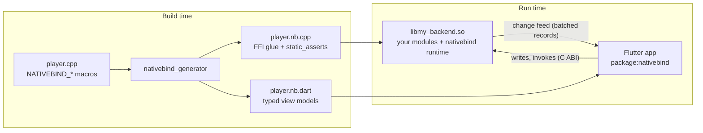

# nativebind

**Write the model in C++, the view in Flutter, and no FFI code at all.**

nativebind binds C++ modules to Flutter over `dart:ffi`, in the spirit of Qt's
`Q_PROPERTY` and QML: you declare properties, lists, signals and methods
with a few macros in an ordinary C++ class, and a code generator produces the
FFI glue plus typed, reactive Dart view models. Properties are
`ValueListenable`s, lists are `List`s, signals are `Stream`s and methods
return `Future`s.

```cpp
// native/modules/player.cpp: the whole C++ side of a feature
#include <nativebind/nativebind.hpp>

class Player : public nativebind::Module {
    NATIVEBIND_MODULE(Player)
public:
    NATIVEBIND_PROP(double, volume, 0.5, .min = 0, .max = 1, .step = 0.05)
    NATIVEBIND_READ(std::string, title, "")
    NATIVEBIND_READ(double, position, 0.0)
    NATIVEBIND_SIGNAL(trackChanged, std::string)

    NATIVEBIND_INVOKE void seek(double seconds) { position = seconds; }
};
```

```dart
// Flutter: generated, typed, reactive
final player = Player.instance;

ValueListenableBuilder(
  valueListenable: player.position,                // rebuilds when C++ assigns it
  builder: (context, seconds, _) => Text('$seconds s'),
);
player.volume.value = 0.8;                          // two-way: C++ validates, Flutter reconciles
player.trackChanged.listen((title) => print('now playing $title'));
await player.seek(42);
```

nativebind knows nothing about your domain. It suits any Flutter app whose
logic or hardware access already lives in C++: embedded Linux devices and
touch panels, desktop tools wrapping a C++ engine, or apps that share a core
library with non-Flutter frontends.

## Contents

- [Features](#features)
- [How it works](#how-it-works)
- [Requirements](#requirements)
- [Quick start](#quick-start)
- [Writing modules (C++)](#writing-modules-c)
- [Using modules (Dart)](#using-modules-dart)
- [Threads and background I/O](#threads-and-background-io)
- [Access control](#access-control)
- [Extending nativebind](#extending-nativebind)
- [Testing](#testing)
- [The generator](#the-generator)
- [Example app](#example-app)
- [Repository layout](#repository-layout)
- [Development](#development)
- [Status](#status)
- [License](#license)

## Features

- **One C++ file per feature.** No headers to keep in sync, no IDL, no
  hand-written FFI, no platform channels.
- **Typed Dart view models.** The generator emits Dart classes, enums and
  immutable data classes (with `copyWith` and `==`) from your C++ declarations,
  including C++ doc comments.
- **Reactive in both directions.** C++ assigns a property and widgets rebuild.
  Flutter writes a property and C++ validates, clamps or rejects it; Flutter
  shows the write right away and reconciles when C++ answers.
- **Built for dragging.** Edit sessions throttle writes while a finger is on a
  slider and ignore incoming values until it lifts.
- **Consistent updates.** Changes are coalesced and applied a batch at a time,
  so widgets never see a half-updated state. `nativebind::Batch` makes a group
  of C++ changes atomic.
- **Incremental lists.** Insert, remove, update and move operations are sent
  separately, so only the changed rows rebuild; a change stream drives
  `AnimatedList`.
- **A simple threading model.** All module logic runs on one "nativebind
  thread", so it needs no locks. Bound members are thread-safe, and
  `nativebind::Worker` runs blocking I/O on its own thread.
- **Safe by construction.** The generated glue re-checks what the generator
  parsed with `static_assert`s, and Dart compares schemas with the native
  library at startup, so stale generated code fails loudly instead of
  corrupting data.
- **Testable.** Modules are plain C++ objects. Views can be tested against the
  real library or against `FakeNative`, a scripted stand-in.
- **Hot restart works.** The native runtime keeps running; Dart reattaches and
  reloads the full state.
- **Extensible, not opinionated.** Free-form property attributes, a write guard,
  module start order and shared Dart type libraries let you build
  domain-specific layers (units, permissions, audit logs, ...) on top.

## How it works



1. You write modules with the `NATIVEBIND_*` macros.
2. CMake runs the generator to produce the C++ glue (`*.nb.cpp`) and compiles
   it with the nativebind runtime into one shared library. Its only exported
   symbols are a small C ABI (`nativebind_*`).
3. `dart run nativebind_generator` writes the Dart side (`*.nb.dart`).
4. At run time, C++ changes go into a change feed. The runtime wakes the Dart
   isolate through a native port, and Dart drains the feed and applies a whole
   batch before notifying listeners. Writes and method calls go the other way
   through the C ABI and are answered asynchronously.

The byte format is documented in
[`packages/nativebind/native/doc/wire-format.md`](packages/nativebind/native/doc/wire-format.md).

## Requirements

| | |
|---|---|
| Flutter / Dart | Flutter 3.24+ / Dart 3.5+ |
| C++ compiler | GCC 11+ or Clang 14+ (C++20) |
| Build | CMake 3.18+ (3.19+ for the app template below), Ninja or Make |
| Platforms | **Linux** (desktop and embedded, e.g. [flutter-pi](https://github.com/ardera/flutter-pi)) is what is built and tested. The runtime is portable C++20 and the Dart side is plain `dart:ffi`, but other platforms have not been tried yet. |

## Quick start

This builds a counter app for Linux desktop. The finished version, with two
more modules, is [`examples/showcase`](examples/showcase).

### 1. Create the app and add the packages

```sh
flutter create --platforms linux my_app && cd my_app
```

nativebind is not on pub.dev yet, so depend on this repository through git:

```yaml
# pubspec.yaml
dependencies:
  nativebind:
    git:
      url: https://github.com/nativebind-hmi/nativebind
      path: packages/nativebind

dev_dependencies:
  nativebind_generator:
    git:
      url: https://github.com/nativebind-hmi/nativebind
      path: packages/nativebind_generator
```

```sh
flutter pub get
```

### 2. Write a module

```cpp
// native/modules/counter.cpp
#include <nativebind/nativebind.hpp>

#include <cstdint>

/// Counts taps.
class Counter : public nativebind::Module {
    NATIVEBIND_MODULE(Counter)
public:
    /// How much each tap adds.
    NATIVEBIND_PROP(int32_t, step, 1, .min = 1, .max = 10)
    NATIVEBIND_READ(int64_t, count, 0)
    /// Sent each time the count passes a multiple of 10.
    NATIVEBIND_SIGNAL(milestone, int64_t)

    NATIVEBIND_INVOKE void increment() {
        const int64_t before = count;
        const int64_t after = before + step;
        count = after;  // assigning a bound value updates Flutter
        if (after / 10 > before / 10) milestone(after / 10 * 10);
    }

    NATIVEBIND_INVOKE void reset() { count = 0; }
};
```

### 3. Build it into a shared library

Copy [`examples/showcase/native/CMakeLists.txt`](examples/showcase/native/CMakeLists.txt)
to `native/CMakeLists.txt`. It finds the nativebind package through
`.dart_tool/package_config.json` and ends with your library:

```cmake
add_library(my_backend SHARED)
nativebind_add_modules(my_backend SOURCES
  modules/counter.cpp)
```

`nativebind_add_modules` runs the generator at build time (and again whenever a
module or a header it includes changes), compiles the glue, and links the
nativebind runtime into `my_backend`.

Then have the Linux runner build the library and bundle it next to the app.
In `linux/CMakeLists.txt`, after `add_subdirectory("runner")`:

```cmake
add_subdirectory("${CMAKE_CURRENT_SOURCE_DIR}/../native" my_native)
add_dependencies(${BINARY_NAME} my_backend)
```

and next to the other `install(...)` rules:

```cmake
install(TARGETS my_backend LIBRARY DESTINATION "${INSTALL_BUNDLE_LIB_DIR}" COMPONENT Runtime)
```

### 4. Generate the Dart side

```sh
dart run nativebind_generator            # reads native/, writes lib/nativebind/
dart run nativebind_generator --watch    # or keep it running while you edit
```

Commit the generated `lib/nativebind/` or generate it in CI; `--check` exits
non-zero when it is stale.

### 5. Start the runtime and bind widgets

```dart
// lib/main.dart
import 'package:flutter/material.dart';
import 'package:nativebind/nativebind.dart';

import 'nativebind/nativebind_modules.dart';

Future<void> main() async {
  WidgetsFlutterBinding.ensureInitialized();
  await NativeBind.start(library: 'libmy_backend.so', modules: nativebindModules);
  runApp(const MaterialApp(home: CounterPage()));
}

class CounterPage extends StatelessWidget {
  const CounterPage({super.key});

  @override
  Widget build(BuildContext context) {
    final counter = Counter.instance;
    return Scaffold(
      body: Center(
        child: ValueListenableBuilder(
          valueListenable: counter.count,
          builder: (context, count, _) => Text('$count', style: Theme.of(context).textTheme.displayLarge),
        ),
      ),
      floatingActionButton: FloatingActionButton(onPressed: counter.increment, child: const Icon(Icons.add)),
    );
  }
}
```

```sh
flutter run -d linux
```

`NativeBind.start` loads the library, checks that every module's generated
Dart code matches it, starts the C++ runtime and loads the complete state, so
the first frame already shows real values.

## Writing modules (C++)

A module is a class derived from `nativebind::Module` whose body starts with
`NATIVEBIND_MODULE`. Each feature is usually one `.cpp` file; several modules
may share a file.

### Declarations

| Macro | Declares | In Dart |
|---|---|---|
| `NATIVEBIND_MODULE(Name)` | a singleton, created when nativebind starts | `Name.instance` |
| `NATIVEBIND_MODULE(Name, .instanced = true)` | any number of instances, created by C++ | `Name.instances`, `Name.byKey(k)` |
| `NATIVEBIND_PROP(T, name, initial[, meta...])` | a property the UI may read and write | `BoundProperty<T>` |
| `NATIVEBIND_READ(T, name, initial[, meta...])` | a property the UI may only read | `BoundValue<T>` |
| `NATIVEBIND_LIST(T, name)` | an observable list | `BoundList<T>` |
| `NATIVEBIND_SIGNAL(name, Args...)` | an event with zero or more arguments | `BoundSignal<T>` (a `Stream`) |
| `NATIVEBIND_INVOKE` | a method the UI may call | `Future<R> name(...)` |
| `NATIVEBIND_INVOKE_AS(permission)` | a method the [guard](#access-control) must allow | `Future<R> name(...)` |

Doc comments (`///`) on modules, members and enumerators are copied to the
generated Dart and are also available at run time (`value.doc`), which makes
them handy as help text.

### Types

| C++ | Dart |
|---|---|
| `bool` | `bool` |
| `int8_t` ... `int64_t`, `uint8_t` ... `uint64_t`, `size_t`, ... | `int` (signed 64-bit) |
| `float`, `double` | `double` |
| `std::string` (`std::string_view` for parameters) | `String` |
| `enum` / `enum class` | enhanced `enum` with `label` (from `///< @label ...` or the name) |
| `struct` of supported types (public fields, no bases) | immutable class with `copyWith`, `==`, `hashCode` |
| `std::vector<T>` | `List<T>` |
| `std::optional<T>` | `T?` |
| `std::chrono::system_clock::time_point` | `DateTime` |
| `std::chrono::duration` (`seconds`, `milliseconds`, ...) | `Duration` |

Aliases (`using`, `typedef`), namespaces and nested types are understood. Give
structs `bool operator==(const T&) const = default;` so nativebind can skip
updates that change nothing.

```cpp
enum class PlayState { Stopped, Playing, Paused };

/// One entry of the play queue.
struct Track {
    int32_t id = 0;
    std::string title;
    std::chrono::seconds length{0};
    bool liked = false;

    bool operator==(const Track&) const = default;
};
```

### Properties

```cpp
NATIVEBIND_PROP(double, volume, 0.5, .min = 0, .max = 1, .step = 0.05, .label = "Volume")
NATIVEBIND_READ(PlayState, state, PlayState::Stopped)
```

Metadata comes after the initial value, in this order:

| Field | Meaning |
|---|---|
| `.min`, `.max` | range for UI writes (clamped); values set by C++ are never clamped |
| `.step` | UI increment; 0 = continuous |
| `.label` | display name (default: derived from the member name) |
| `.attrs` | free-form key/value pairs for your own layers (see [Extending](#extending-nativebind)) |

A `Prop<T>` behaves like a thread-safe `T`:

```cpp
position = 12.5;               // set: Flutter is updated (coalesced)
double v = volume;             // get
volume.set(0.2);               // returns true if it changed
a = b;                         // copies b's value, never the property itself
```

Metadata can change at run time and Flutter follows:

```cpp
volume.setRange(0, 0.8);       // e.g. a limit that depends on the hardware
volume.setStep(0.1);
volume.setEnabled(false);      // shown disabled; UI writes are refused
```

UI writes go through three stages:

1. When the write arrives, the runtime checks that the property is writable
   and enabled and asks the guard; a refusal fails the write at once in Dart.
   On the nativebind thread it checks `enabled` again and clamps the value to
   `[min, max]` as they are then, so metadata C++ changed in the meantime
   applies.
2. `validate(fn)` may accept (`true`), reject (`false`), or replace the value
   (return a `T`, or a `std::optional<T>` that is `nullopt` to reject).
3. `onWrite(fn)` runs after the value is stored. It is not called for changes
   made by C++.

```cpp
Player() {
    volume.validate([](double v) { return std::round(v * 20) / 20; });  // snap to 5 % steps
    volume.onWrite([this](double v) { mixer_.setGain(v); });
}
```

Every write is acknowledged, even a rejected one, so a slider that was moved
to a refused value snaps back.

### Lists

```cpp
NATIVEBIND_LIST(Track, queue)

queue.push_back(track);
queue.insert(0, track);
queue.erase(i);
queue.eraseIf([](const Track& t) { return t.liked; });
queue.set(i, track);
queue.update(i, [](Track& t) { t.liked = !t.liked; });   // edit in place
queue.move(from, to);
queue.assign(tracks);                                     // replace all (one reset)
queue.sync(tracks, [](const Track& t) { return t.id; });  // minimal diff by key
auto i = queue.findIndex([&](const Track& t) { return t.id == id; });
```

Each operation reaches Flutter as one incremental change. Prefer `sync` over
`assign` when refreshing from a data source: rows keep their identity, so
animations and scroll positions survive. Lists are read-only in Dart; change
them through `NATIVEBIND_INVOKE` methods, which keeps the model in C++.

### Signals

```cpp
NATIVEBIND_SIGNAL(trackChanged, std::string)
NATIVEBIND_SIGNAL(finished)                     // no arguments

trackChanged("Intro");                          // from any thread
auto id = trackChanged.connect([](const std::string& t) { log(t); });   // C++ listeners too
trackChanged.disconnect(id);
player.trackChanged.connect(*this, [this](const std::string& t) { show(t); });  // ends with *this
```

Signals are for events without a current value ("track ended", "login
failed"). For state, use a property. Flutter receives every signal emitted
while it is attached, including those from `onStart`; signals emitted while
no isolate is attached are not kept.

C++ listeners run on the emitting thread. When a listener uses another
module, pass that module to `connect`: the connection then ends when the
module is destroyed (after its `onStop`), whichever of the two goes first.
`disconnect` returns only once the listener is no longer running on another
thread, so a listener must not wait for the thread that disconnects it.

### Methods

```cpp
NATIVEBIND_INVOKE int32_t add(std::string title, std::string artist, int32_t seconds);
NATIVEBIND_INVOKE void seek(double seconds);
```

Arguments and results may be any supported type. Methods run on the nativebind
thread. If one throws, the Dart `Future` completes with a
`BindInvokeException` carrying the message. Methods cannot be overloaded, and
C++ default arguments become required parameters in Dart.

### Lifecycle

```cpp
class Player : public nativebind::Module {
    NATIVEBIND_MODULE(Player)
public:
    Player() { /* initial values, setRange/setEnabled, validate/onWrite, Batch */ }
protected:
    void onStart() override {   // every singleton exists now
        every(100ms, [this] { tick(); });
    }
    void onStop() override { /* stop workers, release devices */ }
};
```

| Where | What belongs there |
|---|---|
| constructor | initial values, metadata, `validate`/`onWrite` handlers. All of it arrives in Flutter as the initial state. |
| `onStart()` | anything that needs other modules (`property<T>`, `singleton<T>`, typed references) and timers |
| `onStop()` | stopping workers, closing devices |

Timers and posting, all on the nativebind thread and cancelled automatically
when the module is destroyed:

```cpp
auto id = every(1s, [this] { poll(); });
after(500ms, [this] { timeout(); });
cancel(id);
post([this] { later(); });       // from any thread
```

### Instanced modules

```cpp
class Download : public nativebind::Module {
    NATIVEBIND_MODULE(Download, .instanced = true)
public:
    NATIVEBIND_READ(std::string, name, "")
    NATIVEBIND_READ(double, progress, 0.0)
    Download(std::string fileName, int64_t bytes);
};

// Anywhere in C++ (any thread):
Download& d = nativebind::spawn<Download>(key, "file.bin", 1 << 20);  // key: unique per type
nativebind::destroy(d);                                              // async; onStop runs first
for (Download* d : nativebind::instances<Download>()) { ... }        // on the nativebind thread
```

In Dart, `Download.instances` is a `ValueListenable<List<Download>>` ordered by
key, and `Download.byKey(k)` finds one.

### Reaching other modules

Modules do not need headers to talk to each other. By name, checked at run
time:

```cpp
void onStart() override {
    volume_ = &nativebind::property<double>("Player", "volume");   // throws on a typo or wrong type
    auto& downloads = nativebind::singleton<Downloads>();          // if the type is visible
}
```

Or typed: the generator also writes `<module>.nb.hpp` next to the glue, with
references to every property and list:

```cpp
#include "player.nb.hpp"

void onStart() override {
    auto player = nativebind::ref::Player::get();   // singleton; ::get(key) for instances
    double v = player.volume;
}
```

Members whose type is declared inside the other module's `.cpp` are left out
of its `.nb.hpp`; move shared types into a header to reach them.

## Using modules (Dart)

### Values

Every property is a `ValueListenable` that notifies when its value or its
metadata changes:

| Member | |
|---|---|
| `value` | current value; for writable properties includes a pending write |
| `meta` | `min`, `max`, `step`, `label`, `writable`, `enabled`, `attrs`, live from C++ |
| `doc` | the C++ doc comment |
| `choices` | all values of an enum or bool property, for pickers |
| `hasValue`, `isAlive` | the first value arrived; the instance still exists in C++ |

```dart
ListenableBuilder(
  listenable: Listenable.merge([player.title, player.state, player.position]),
  builder: (context, _) => Text('${player.title.value} · ${player.state.value.label}'),
);
```

C++ changes are coalesced, and a whole batch is applied before any listener
runs, so widgets never see a half-updated state.

### Writes

```dart
player.volume.value = 0.8;                       // optimistic: shows at once
final kept = await player.volume.write(2);       // what C++ kept: 1.0 (clamped)
player.volume.isPending;                         // true until C++ acknowledged it
if (!player.volume.canWrite) ...                 // read-only, disabled or refused by the guard
player.volume.whyNotWritable;                    // the reason, as a BindException
```

Writes are sequence-numbered. Flutter shows the written value until C++
acknowledges that write, then shows whatever C++ decided.

For dragging, open an edit session. While it is open, incoming values do not
move the control, and writes are throttled (10 per second by default):

```dart
Slider(
  value: volume,
  onChangeStart: (_) => edit = player.volume.beginEdit(),
  onChanged: (v) => edit?.update(v),             // shown now, sent at most every 100 ms
  onChangeEnd: (v) { edit?.commit(v); edit = null; },
);
```

### Lists, signals, methods

```dart
ListView(children: [for (final t in player.queue) TrackTile(t)]);   // BoundList is a List
player.queue.changes.listen((c) => ...);    // ListInserted/Removed/Updated/Moved/Reset, for AnimatedList
player.trackChanged.listen((title) => ...); // BoundSignal is a broadcast Stream
final id = await player.add('Intro', 'Me', 90);
```

### Instances

```dart
ValueListenableBuilder(
  valueListenable: Download.instances,      // ordered by key
  builder: (context, list, _) => ListView(children: [for (final d in list) DownloadTile(d)]),
);
Download.byKey(3)?.progress;
download.isAlive;                           // false once C++ destroyed it
```

### Generic UIs

`module.$values` lists every property of a module, and each value carries its
`meta`, `doc` and `choices`. That is enough to build settings pages, parameter
lists or debug inspectors without naming each property.

### Errors

| Exception | When |
|---|---|
| `BindSchemaMismatch` | The generated Dart and the native library differ; the message shows the differing lines. Regenerate and rebuild. |
| `BindNotStarted` | `NativeBind.start` was not called, the library was not found, or a module is missing from it |
| `BindAccessDenied` | Refused by the guard (C++ or `NativeBind.writeGuard`) |
| `BindWriteRejected` | The property is read-only or disabled |
| `BindInvokeException` | The C++ method threw; carries its message |
| `BindInstanceGone` | The instance was destroyed in C++ |

### Finding the library

`NativeBind.start(library: 'libmy_backend.so')` searches, in order: the
directories in `NATIVEBIND_LIBRARY_PATH` (colon-separated), the system loader
path (`LD_LIBRARY_PATH`, `/usr/lib`, ...), and `lib/` next to the executable
(Flutter desktop bundles). A path containing `/` is opened as given. Under
flutter-pi the executable is flutter-pi itself, so install the library
system-wide or set `NATIVEBIND_LIBRARY_PATH`.

## Threads and background I/O

- UI writes, invokes, timers, `onStart` and `onStop` all run on the single
  **nativebind thread**, so module logic needs no locks.
- Properties, lists and signals are thread-safe and may be changed from any
  thread.
- Blocking I/O (sockets, serial ports, device drivers, slow files) must never
  run on the nativebind thread. Give the module a `nativebind::Worker`, a
  thread with a task queue and periodic jobs:

```cpp
class Download : public nativebind::Module {
    NATIVEBIND_MODULE(Download, .instanced = true)
public:
    NATIVEBIND_READ(int64_t, received, 0)
    NATIVEBIND_READ(double, progress, 0.0)
    NATIVEBIND_PROP(int32_t, speed, 512, .min = 64, .max = 4096)

    Download() {
        // UI writes arrive on the nativebind thread; hand them to the I/O thread.
        speed.onWrite([this](int32_t v) { io_.post([this, v] { socket_.setRate(v); }); });
    }
protected:
    void onStart() override { io_.every(100ms, [this] { transfer(); }); }
private:
    void transfer() {                          // on io_: blocking is fine here
        auto n = socket_.read(buffer_);
        nativebind::Batch batch;               // Flutter sees both or neither
        received = received + n;
        progress = double(received) / total_;
    }
    Socket socket_;                            // used only on io_
    nativebind::Worker io_{*this, "download"}; // stopped after onStop, before the rest goes away
};
```

| From a worker you may | Notes |
|---|---|
| set properties and metadata, change lists, emit signals | thread-safe |
| `post(fn)` to run module logic on the nativebind thread | for state shared with `NATIVEBIND_INVOKE` methods |
| open a `nativebind::Batch` to publish related values together | keep it short, never do I/O inside one |

| Don't | Instead |
|---|---|
| block the nativebind thread (I/O in `onWrite`, invokes, timers) | `io_.post(...)` |
| share plain members between a worker and the nativebind thread | a bound property, or `post` |
| let a worker outlive its module | give it its module, `Worker io_{*this, "name"}`, or `io_.stop()` in `onStop()` |

`Worker::sleepFor` returns early when the worker stops, for long loops.
Workers get thread names (visible in `top -H` and debuggers), and an exception
in a task is logged instead of killing the thread.

## Access control

A guard decides every UI write and every `NATIVEBIND_INVOKE_AS` call:

```cpp
enum class Role { Viewer, Operator, Admin };
std::atomic<Role> currentRole{Role::Viewer};

class Device : public nativebind::Module {
    NATIVEBIND_MODULE(Device)
public:
    NATIVEBIND_PROP(int32_t, brightness, 50, .min = 0, .max = 100, .attrs = {{"role", Role::Operator}})
    NATIVEBIND_INVOKE_AS(Role::Admin) void factoryReset();
};

nativebind::setGuard([](const nativebind::GuardRequest& r) -> std::string {
    int64_t need = r.permission;                                   // invokes: the INVOKE_AS argument
    if (r.meta)                                                    // writes: the property's metadata
        for (const auto& a : r.meta->attrs)
            if (a.key == "role") need = std::get<int64_t>(a.value.get());
    return int64_t(currentRole.load()) >= need ? "" : "requires a higher role";
});
```

The guard returns an empty string to allow, or the reason it refuses (Dart
gets a `BindAccessDenied` with it). It runs on the calling thread with runtime
locks held: keep it fast, only read state (an atomic, as above), and never
call into nativebind from it. Without a guard, writes are allowed and
`NATIVEBIND_INVOKE_AS` methods are refused: it fails closed.

To let the UI show a lock or ask for a login *before* a write fails, mirror the
policy in Dart:

```dart
NativeBind.writeGuard = (property) =>
    (property.meta.attr<int>('role') ?? 0) > currentRole ? const BindAccessDenied('log in first') : null;
```

`BoundProperty.canWrite` and `whyNotWritable` take it into account. C++ always
has the final word.

## Extending nativebind

nativebind has no domain concepts. Libraries built on it (for display units,
user roles, data quality, event logs, ...) use four generic hooks:

- **Attributes.** `Meta::attrs` carries any key to a bool, integer (or enum),
  double or string. nativebind sends them to Dart unchanged, where
  `meta.attrs` and `meta.attr<T>(key)` read them. Wrap them in your own helpers
  and Dart extension getters:

  ```cpp
  NATIVEBIND_READ(double, pressure, 0.0, .attrs = {{"unit", "kPa"}, {"decimals", 1}})
  ```
  ```dart
  extension on PropertyMeta {
    String get unit => attr<String>('unit') ?? '';
  }
  ```

- **The guard**, described [above](#access-control), with `NativeBind.writeGuard`
  as its Dart mirror.
- **Module order.** `NATIVEBIND_MODULE(Name, .order = -100)` creates a singleton
  before the others and destroys it after them, for infrastructure (a session,
  a log, a settings store) that other modules use while starting and stopping.
- **Shared Dart types.** A header that declares
  `NATIVEBIND_DART_LIBRARY("package:my_lib/my_lib.dart")` has its enums and
  structs imported from that Dart library in apps' generated code instead of
  being generated again. A Dart package ships such headers in
  `<package>/native/include`; `dart run nativebind_generator` finds that
  directory in every dependency, and CMake builds register it with
  `nativebind_add_header_dirs(...)`. The library generates its own copy with
  `--provides package:my_lib/my_lib.dart`.

## Testing

### C++ modules

A module is a plain object: construct it and test its logic without the
runtime or Flutter. For tests that need the runtime, call
`nativebind::start()` and `nativebind::stop()` yourself;
`nativebind::flush()` waits until everything posted to the nativebind thread
has run.

### Views against a scripted native side

`FakeNative` (from `package:nativebind/testing.dart`) stands in for the
library. You script change-feed records exactly as C++ would send them, and
inspect the writes and invokes the UI made. Members are addressed by
declaration index:

```dart
import 'package:nativebind/testing.dart';

testWidgets('shows the count', (tester) async {
  final native = FakeNative(nativebindModules);
  native.feed
    ..resync()
    ..added(1, native.idOf('Counter'))     // instance handle 1
    ..meta(1, 0, min: 1, max: 10)          // step
    ..prop(1, 0, i(2))
    ..meta(1, 1, writable: false)          // count
    ..prop(1, 1, i(41));
  native.publish();
  await NativeBind.start(native: native, modules: nativebindModules);

  await tester.pumpWidget(const MaterialApp(home: CounterPage()));
  expect(find.text('41'), findsOneWidget);

  await tester.tap(find.text('Add'));
  expect(native.invokes.single.index, 0);  // increment()
});
```

### Views against the real library

Build the library (the example's test runs CMake in `setUpAll`) and start
nativebind with its path. `testWidgets` runs in fake time while C++ runs in
real time, so:

- start nativebind and await C++ calls inside `tester.runAsync(...)`;
- after letting C++ run, call `NativeBind.instance.drainNow()` and `pump()`;
- don't `await` a `StreamSubscription.cancel()` of a signal in a widget test:
  it completes outside fake time and stalls the test;
- use `pump(duration)` rather than `pumpAndSettle` when something animates
  forever.

```dart
Future<void> run(WidgetTester tester, [int ms = 50]) async {
  await tester.runAsync(() => Future<void>.delayed(Duration(milliseconds: ms)));
  NativeBind.instance.drainNow();
  await tester.pump();
}
```

`NativeBind` is a process-wide singleton: add `tearDown(NativeBind.stop)` to
every test file.

## The generator

```sh
dart run nativebind_generator                         # scan ./native, write lib/nativebind/
dart run nativebind_generator native/modules --dart-out lib/src/nativebind
dart run nativebind_generator --watch                 # regenerate on save
dart run nativebind_generator --check                 # CI: exit code 3 if anything is stale
dart run nativebind_generator -I third_party/include  # extra header directories
dart run nativebind_generator --help
```

The generator is a dependency-free Dart program with a purpose-built parser
for the `NATIVEBIND_*` declarations; it is not a C++ compiler. It therefore
asks the compiler to confirm what it read: the generated glue contains a
`static_assert` per property, list, struct field and enumerator, and a
structured binding per struct that fails to compile if a field was missed.
Errors look like compiler diagnostics:

```
native/modules/player.cpp:14:17: error: unknown type `Mode` for property `mode`
  hint: define the enum or struct in this file or in a header it includes with #include "..."
```

Limitations: preprocessor conditionals are not evaluated (members inside `#if`
are always seen, and the runtime check reports the mismatch), and macro
arguments split at top-level commas, so give types like `std::pair<int, int>`
an alias first.

CMake runs the generator for the C++ side through `nativebind_add_modules`. To
use a precompiled generator (for example when cross-compiling in an SDK
without Dart), compile it with `dart compile exe` and pass
`-DNATIVEBIND_GENERATOR=/path/to/nativebind_generator`.

See [`packages/nativebind_generator`](packages/nativebind_generator/README.md)
for details.

## Example app

[`examples/showcase`](examples/showcase) is a small Linux desktop app with
three modules, each a single C++ file:

| Module | Shows |
|---|---|
| [`counter.cpp`](examples/showcase/native/modules/counter.cpp) | the basics: a writable property with a range, a read-only value, a signal, methods |
| [`player.cpp`](examples/showcase/native/modules/player.cpp) | a simulated media player: enums, a list of structs, `validate`, a timer, `Batch`, methods with results, edit sessions in Dart |
| [`downloads.cpp`](examples/showcase/native/modules/downloads.cpp) | instanced modules spawned from C++, a `Worker` thread per download, C++ signal connections across modules |

```sh
cd examples/showcase
flutter pub get
dart run nativebind_generator
flutter run -d linux
flutter test        # widget tests against the real library and against FakeNative
```

## Repository layout

| Path | |
|---|---|
| [`packages/nativebind`](packages/nativebind) | the Dart runtime (`lib/`) and the C++ runtime (`native/`) |
| [`packages/nativebind/native`](packages/nativebind/native) | C++20 runtime, CMake integration, C ABI, wire-format docs and tests |
| [`packages/nativebind_generator`](packages/nativebind_generator) | the code generator (`dart run nativebind_generator`) |
| [`examples/showcase`](examples/showcase) | the example app |

## Development

```sh
# C++ runtime, with sanitizers
cd packages/nativebind/native
cmake -B build/asan -G Ninja -DCMAKE_BUILD_TYPE=Debug -DNATIVEBIND_SANITIZE=address,undefined
cmake --build build/asan && ./build/asan/tests/nativebind_tests
cmake -B build/tsan -G Ninja -DCMAKE_BUILD_TYPE=Debug -DNATIVEBIND_SANITIZE=thread
cmake --build build/tsan && ./build/tsan/tests/nativebind_tests

# Generator (includes compiling generated glue with g++/clang++)
cd packages/nativebind_generator && dart test

# Dart runtime (unit tests + integration tests against the real C++ library)
cd packages/nativebind && flutter test

# Example
cd examples/showcase && flutter test
```

Run `dart analyze` / `flutter analyze` as well. Performance tests are tagged
`perf` (`flutter test --tags perf`), and `nativebind_bench` is the C++
benchmark. See [CONTRIBUTING.md](CONTRIBUTING.md) for the rules that keep the
generated code, wire format and threading model consistent.

## Status

Version 0.1.0 is the first public release. The API may still change before
1.0; breaking changes are listed in [CHANGELOG.md](CHANGELOG.md). The wire
format and C ABI are versioned (`NATIVEBIND_ABI_VERSION`), and the Dart side
refuses to talk to a library with a different version.

## License

MIT; see [LICENSE](LICENSE). `packages/nativebind/native/third_party/dart_api`
contains headers from the Dart SDK under their own BSD-3-Clause license.
