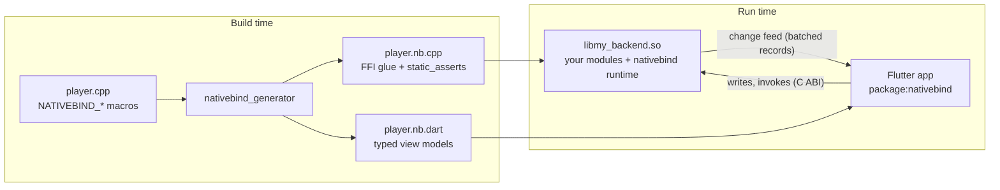

# nativebind

**Write the model in C++, the view in Flutter, and no FFI code at all.**

nativebind binds C++ modules to Flutter over `dart:ffi`, in the spirit of Qt's
`Q_PROPERTY` and QML: you declare properties, lists, signals and methods
with a few macros in an ordinary C++ class, and a code generator produces the
FFI glue plus typed, reactive Dart view models. Properties are
`ValueListenable`s, lists are `List`s, signals are `Stream`s and methods
return `Future`s.

```cpp
// native/modules/player.cpp: the whole C++ side of a feature
#include <nativebind/nativebind.hpp>

class Player : public nativebind::Module {
    NATIVEBIND_MODULE(Player)
public:
    NATIVEBIND_PROP(double, volume, 0.5, .min = 0, .max = 1, .step = 0.05)
    NATIVEBIND_READ(std::string, title, "")
    NATIVEBIND_READ(double, position, 0.0)
    NATIVEBIND_SIGNAL(trackChanged, std::string)

    NATIVEBIND_INVOKE void seek(double seconds) { position = seconds; }
};
```

```dart
// Flutter: generated, typed, reactive
final player = Player.instance;

ValueListenableBuilder(
  valueListenable: player.position,                // rebuilds when C++ assigns it
  builder: (context, seconds, _) => Text('$seconds s'),
);
player.volume.value = 0.8;                          // two-way: C++ validates, Flutter reconciles
player.trackChanged.listen((title) => print('now playing $title'));
await player.seek(42);
```

nativebind knows nothing about your domain. It suits any Flutter app whose
logic or hardware access already lives in C++: embedded Linux devices and
touch panels, desktop tools wrapping a C++ engine, or apps that share a core
library with non-Flutter frontends.

## Contents

- [Features](#features)
- [How it works](#how-it-works)
- [Requirements](#requirements)
- [Quick start](#quick-start)
- [API at a glance](#api-at-a-glance)
- [Documentation](#documentation)
- [Example app](#example-app)
- [Repository layout](#repository-layout)
- [Contributing](#contributing)
- [Status](#status)
- [License](#license)

## Features

- **One C++ file per feature.** No headers to keep in sync, no IDL, no
  hand-written FFI, no platform channels.
- **Typed Dart view models.** The generator emits Dart classes, enums and
  immutable data classes (with `copyWith` and `==`) from your C++ declarations,
  including C++ doc comments.
- **Reactive in both directions.** C++ assigns a property and widgets rebuild.
  Flutter writes a property and C++ validates, clamps or rejects it; Flutter
  shows the write right away and reconciles when C++ answers.
- **Built for dragging.** Edit sessions throttle writes while a finger is on a
  slider and ignore incoming values until it lifts.
- **Consistent updates.** Changes are coalesced and applied a batch at a time,
  so widgets never see a half-updated state. `nativebind::Batch` makes a group
  of C++ changes atomic.
- **Incremental lists.** Insert, remove, update and move operations are sent
  separately, so only the changed rows rebuild; a change stream drives
  `AnimatedList`.
- **A simple threading model.** All module logic runs on one "nativebind
  thread", so it needs no locks. Bound members are thread-safe, and
  `nativebind::Worker` runs blocking I/O on its own thread.
- **Safe by construction.** The generated glue re-checks what the generator
  parsed with `static_assert`s, and Dart compares schemas with the native
  library at startup, so stale generated code fails loudly instead of
  corrupting data.
- **Testable.** Modules are plain C++ objects. Views can be tested against the
  real library or against `FakeNative`, a scripted stand-in.
- **Hot restart works.** The native runtime keeps running; Dart reattaches and
  reloads the full state.
- **Extensible, not opinionated.** Free-form property attributes, a write guard,
  module start order and shared Dart type libraries let you build
  domain-specific layers (units, permissions, audit logs, ...) on top.

## How it works



1. You write modules with the `NATIVEBIND_*` macros.
2. CMake runs the generator to produce the C++ glue (`*.nb.cpp`) and compiles
   it with the nativebind runtime into one shared library. Its only exported
   symbols are a small C ABI (`nativebind_*`).
3. `dart run nativebind_generator` writes the Dart side (`*.nb.dart`).
4. At run time, C++ changes go into a change feed. The runtime wakes the Dart
   isolate through a native port, and Dart drains the feed and applies a whole
   batch before notifying listeners. Writes and method calls go the other way
   through the C ABI and are answered asynchronously.

The byte format is documented in
[`packages/nativebind/native/doc/wire-format.md`](packages/nativebind/native/doc/wire-format.md).

## Requirements

| | |
|---|---|
| Flutter / Dart | Flutter 3.24+ / Dart 3.5+ |
| C++ compiler | GCC 11+ or Clang 14+ (C++20), with RTTI (`typeid` maps types to modules and structs; `-fno-rtti` does not build) |
| Build | CMake 3.18+ (3.19+ for the app template below), Ninja or Make |
| Platforms | **Linux** (desktop and embedded, e.g. [flutter-pi](https://github.com/ardera/flutter-pi)) is what is built and tested. The runtime is portable C++20 and the Dart side is plain `dart:ffi`, but other platforms have not been tried yet. |

## Quick start

This builds a counter app for Linux desktop. The finished version, with two
more modules, is [`examples/showcase`](examples/showcase).

### 1. Create the app and add the packages

```sh
flutter create --platforms linux my_app && cd my_app
```

Add the runtime, and the generator as a development dependency:

```sh
flutter pub add nativebind dev:nativebind_generator
```

To follow unreleased changes instead, depend on this repository through git
(`git: {url: https://github.com/trevortomlin/nativebind, path: packages/nativebind}`,
and the same with `path: packages/nativebind_generator`).

### 2. Write a module

```cpp
// native/modules/counter.cpp
#include <nativebind/nativebind.hpp>

#include <cstdint>

/// Counts taps.
class Counter : public nativebind::Module {
    NATIVEBIND_MODULE(Counter)
public:
    /// How much each tap adds.
    NATIVEBIND_PROP(int32_t, step, 1, .min = 1, .max = 10)
    NATIVEBIND_READ(int64_t, count, 0)
    /// Sent each time the count passes a multiple of 10.
    NATIVEBIND_SIGNAL(milestone, int64_t)

    NATIVEBIND_INVOKE void increment() {
        const int64_t before = count;
        const int64_t after = before + step;
        count = after;  // assigning a bound value updates Flutter
        if (after / 10 > before / 10) milestone(after / 10 * 10);
    }

    NATIVEBIND_INVOKE void reset() { count = 0; }
};
```

### 3. Build it into a shared library

Copy [`examples/showcase/native/CMakeLists.txt`](examples/showcase/native/CMakeLists.txt)
to `native/CMakeLists.txt`. It finds the nativebind package through
`.dart_tool/package_config.json` and ends with your library:

```cmake
add_library(my_backend SHARED)
nativebind_add_modules(my_backend SOURCES
  modules/counter.cpp)
```

`nativebind_add_modules` runs the generator at build time (and again whenever a
module or a header it includes changes), compiles the glue, and links the
nativebind runtime into `my_backend`. It also hides every symbol except the
`nativebind_*` C ABI, unless you set the target's visibility yourself.

Then have the Linux runner build the library and bundle it next to the app.
In `linux/CMakeLists.txt`, after `add_subdirectory("runner")`:

```cmake
add_subdirectory("${CMAKE_CURRENT_SOURCE_DIR}/../native" my_native)
add_dependencies(${BINARY_NAME} my_backend)
```

and next to the other `install(...)` rules:

```cmake
install(TARGETS my_backend LIBRARY DESTINATION "${INSTALL_BUNDLE_LIB_DIR}" COMPONENT Runtime)
```

### 4. Generate the Dart side

```sh
dart run nativebind_generator            # reads native/, writes lib/nativebind/
dart run nativebind_generator --watch    # or keep it running while you edit
```

Commit the generated `lib/nativebind/` or generate it in CI; `--check` exits
non-zero when it is stale.

### 5. Start the runtime and bind widgets

```dart
// lib/main.dart
import 'package:flutter/material.dart';
import 'package:nativebind/nativebind.dart';

import 'nativebind/nativebind_modules.dart';

Future<void> main() async {
  WidgetsFlutterBinding.ensureInitialized();
  await NativeBind.start(library: 'libmy_backend.so', modules: nativebindModules);
  runApp(const MaterialApp(home: CounterPage()));
}

class CounterPage extends StatelessWidget {
  const CounterPage({super.key});

  @override
  Widget build(BuildContext context) {
    final counter = Counter.instance;
    return Scaffold(
      body: Center(
        child: ValueListenableBuilder(
          valueListenable: counter.count,
          builder: (context, count, _) => Text('$count', style: Theme.of(context).textTheme.displayLarge),
        ),
      ),
      floatingActionButton: FloatingActionButton(onPressed: counter.increment, child: const Icon(Icons.add)),
    );
  }
}
```

```sh
flutter run -d linux
```

`NativeBind.start` loads the library, checks that every module's generated
Dart code matches it, starts the C++ runtime and loads the complete state, so
the first frame already shows real values.

## API at a glance

| C++ | Declares | In Dart |
|---|---|---|
| `NATIVEBIND_MODULE(Name)` | a singleton module | `Name.instance` |
| `NATIVEBIND_MODULE(Name, .instanced = true)` | instances spawned by C++ (`nativebind::spawn<Name>(key, ...)`) | `Name.instances`, `Name.byKey(k)` |
| `NATIVEBIND_PROP(T, name, initial[, .min, .max, .step, .label, .attrs])` | a property the UI may read and write | `BoundProperty<T>`: `value`, `write()`, `beginEdit()`, `canWrite`, `isPending` |
| `NATIVEBIND_READ(T, name, initial[, ...])` | a property the UI may only read | `BoundValue<T>`: `value`, `meta`, `doc`, `choices` |
| `NATIVEBIND_LIST(T, name)` | an observable list | `BoundList<T>`: a read-only `List<T>` plus a `changes` stream |
| `NATIVEBIND_SIGNAL(name, Args...)` | an event | `BoundSignal<T>`: a broadcast `Stream` |
| `NATIVEBIND_INVOKE` | a method the UI may call | `Future<R> name(...)` |
| `NATIVEBIND_INVOKE_AS(permission)` | a method the guard must allow | `Future<R> name(...)` |

Types: `bool`, integers, `double`, `std::string`, enums, structs,
`std::vector`, `std::optional`, `std::chrono` time points and durations. In C++,
`nativebind::Worker` runs blocking I/O on its own thread, `nativebind::Batch`
publishes related changes together, and `nativebind::setGuard` decides UI
writes and guarded calls. In Dart, `NativeBind.start`/`stop` run it and
`FakeNative` stands in for the library in tests.

## Documentation

The [guide](docs/guide.md) covers everything in detail:

- [Writing modules (C++)](docs/guide.md#writing-modules-c): declarations,
  types, properties, lists, signals, methods, lifecycle, instances, reaching
  other modules
- [Using modules (Dart)](docs/guide.md#using-modules-dart): values, writes and
  edit sessions, lists, signals, instances, errors, finding the library
- [Threads and background I/O](docs/guide.md#threads-and-background-io)
- [Access control](docs/guide.md#access-control) and
  [extending nativebind](docs/guide.md#extending-nativebind)
- [Testing](docs/guide.md#testing) C++ modules and Flutter views
- [Building with CMake](docs/guide.md#building-with-cmake) and
  [the generator](docs/guide.md#the-generator)
- [Troubleshooting](docs/guide.md#troubleshooting)

The byte format between the two sides is in
[`wire-format.md`](packages/nativebind/native/doc/wire-format.md).

## Example app

[`examples/showcase`](examples/showcase) is a small Linux desktop app with
three modules, each a single C++ file:

| Module | Shows |
|---|---|
| [`counter.cpp`](examples/showcase/native/modules/counter.cpp) | the basics: a writable property with a range, a read-only value, a signal, methods |
| [`player.cpp`](examples/showcase/native/modules/player.cpp) | a simulated media player: enums, a list of structs, `validate`, a timer, `Batch`, methods with results, edit sessions in Dart |
| [`downloads.cpp`](examples/showcase/native/modules/downloads.cpp) | instanced modules spawned from C++, a `Worker` thread per download, C++ signal connections across modules |

```sh
cd examples/showcase
flutter pub get
dart run nativebind_generator
flutter run -d linux
flutter test        # widget tests against the real library and against FakeNative
```

## Repository layout

| Path | |
|---|---|
| [`packages/nativebind`](packages/nativebind) | the Dart runtime (`lib/`) and the C++ runtime (`native/`) |
| [`packages/nativebind/native`](packages/nativebind/native) | C++20 runtime, CMake integration, C ABI, wire-format docs and tests |
| [`packages/nativebind_generator`](packages/nativebind_generator) | the code generator (`dart run nativebind_generator`) |
| [`examples/showcase`](examples/showcase) | the example app |
| [`docs`](docs) | the guide |
| [`tool`](tool) | maintenance scripts (regenerating checked-in generated code) |

## Contributing

See [CONTRIBUTING.md](CONTRIBUTING.md) for building and testing everything,
and for the rules that keep the generated code, wire format and threading
model consistent.

## Status

nativebind is in 0.x: the API may still change before 1.0, and breaking
changes are listed in [CHANGELOG.md](CHANGELOG.md). The wire format and C ABI
are versioned (`NATIVEBIND_ABI_VERSION`), and the Dart side refuses to talk to
a library with a different version. Releases are described in
[RELEASING.md](RELEASING.md).

## License

MIT; see [LICENSE](LICENSE). `packages/nativebind/native/third_party/dart_api`
contains headers from the Dart SDK under their own BSD-3-Clause license.
